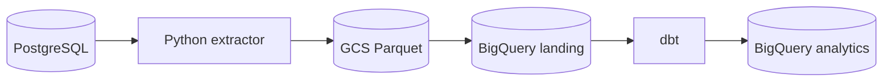

# Kumparan Data Engineering Assessment

An hourly ELT pipeline from PostgreSQL to GCS and BigQuery, orchestrated by
Kestra and transformed with dbt. It supports bounded historical backfills and
hourly incremental processing.

## Design



Kestra orchestrates the hourly and historical backfill flows.

## Prerequisites

Docker Engine or Docker Desktop with Docker Compose v2 is required. The complete
pipeline also requires:

- A Google Cloud project with billing enabled
- Google Cloud CLI (`gcloud` and `bq`)
- Terraform 1.6 or newer
- Permission to enable APIs and manage GCS, BigQuery, service accounts, and IAM

GNU Make is optional.

## 1. Configure Google Cloud

```bash
gcloud auth application-default login

cp infrastructure/terraform/terraform.tfvars.example \
  infrastructure/terraform/terraform.tfvars
cp .env.example .env
```

Replace the placeholders in both files. The bucket name must be new and
globally unique. Keep these values aligned:

| `terraform.tfvars` | `.env` |
| --- | --- |
| `project_id` | `GCP_PROJECT_ID` |
| `raw_bucket_name` | `GCS_RAW_BUCKET` |
| `location` | `BIGQUERY_LOCATION` |
| `landing_dataset_id` | `BIGQUERY_LANDING_DATASET` |
| `analytics_dataset_id` | `BIGQUERY_ANALYTICS_DATASET` |

Load the runtime values and configure ADC:

```bash
set -a
. ./.env
set +a

gcloud config set project "$GCP_PROJECT_ID"
gcloud auth application-default set-quota-project "$GCP_PROJECT_ID"

export GOOGLE_APPLICATION_CREDENTIALS_HOST_PATH="$(
  gcloud info --format='value(config.paths.global_config_dir)'
)/application_default_credentials.json"

test -r "$GOOGLE_APPLICATION_CREDENTIALS_HOST_PATH"
```

## 2. Provision GCP

```bash
terraform -chdir=infrastructure/terraform init
terraform -chdir=infrastructure/terraform validate
terraform -chdir=infrastructure/terraform plan -out=deployment.tfplan
terraform -chdir=infrastructure/terraform apply deployment.tfplan
terraform -chdir=infrastructure/terraform output
```

Terraform creates the bucket, BigQuery datasets, required APIs, and a keyless
pipeline service account. Local containers use your ADC credentials.

## 3. Start the pipeline

```bash
docker compose build article-ingestion
docker compose up -d --wait source-postgres kestra
```

Or, using a Make command:

```bash
make orchestration-up
```

Open <http://localhost:8080> and sign in:

```text
Username: admin@localhost.dev
Password: Admin1234!
```

## 4. Run an end-to-end test

In Kestra, execute `kumparan.dev.articles_historical_backfill` with:

```text
window_start = 2026-11-01T00:00:00Z
window_end   = 2026-12-01T00:00:00Z
```

This seeded interval runs the complete path:

```text
PostgreSQL → GCS → BigQuery landing → dbt models → analytical mart
```

Wait until the parent execution and its subflows show `SUCCESS`.

## 5. Verify the output

```bash
gcloud storage ls --recursive "gs://$GCS_RAW_BUCKET/"

bq head --max_rows=10 \
  "$GCP_PROJECT_ID:$BIGQUERY_LANDING_DATASET.article_observations"

bq head --max_rows=10 \
  "$GCP_PROJECT_ID:$BIGQUERY_ANALYTICS_DATASET.articles_current"

bq head --max_rows=10 \
  "$GCP_PROJECT_ID:$BIGQUERY_ANALYTICS_DATASET.active_article_author_daily"
```

## Execution evidence

See [execution evidence](docs/EVIDENCE.md) for the end-to-end run and one-million-row volume test.

## Available flows

- `articles_window_ingest`: extract and load one explicit interval.
- `articles_historical_backfill`: process a bounded range in monthly chunks.
- `articles_hourly`: process hourly `updated_at` windows after a one-hour grace
  period.

## Run the flows in Kestra

### Hourly schedule

Kestra watches the mounted flow files. Once it has loaded `articles_hourly`,
the hourly schedule is enabled automatically. It runs at minute 00 of each hour
in UTC. The one-hour grace period means a run scheduled for 03:00 UTC extracts
source rows with `updated_at` in `[01:00, 02:00)`; the end of the interval is
excluded. When that interval contains rows, the execution extracts them from
PostgreSQL, loads them into BigQuery, and runs dbt through to the analytics
mart. Empty intervals skip the dbt step.

If Kestra first starts at 03:15 UTC, its next regular run is at 04:00 UTC. If
Kestra restarts after being unavailable, this flow is configured to recover
missed scheduled times. To inspect hourly runs, open **Executions** in the left
sidebar and filter for `articles_hourly`.

### Historical backfill

To start or rerun a backfill, open **Flows** in the left sidebar, select
`articles_historical_backfill`, click **Execute** in the upper-right corner,
and enter `window_start` and `window_end`. Use UTC timestamps in this format:

```text
window_start = 2016-01-01T00:00:00Z
window_end   = 2026-12-01T00:00:00Z
```

`window_start` is inclusive and `window_end` is exclusive, so these example
bounds select rows where `created_at` is on or after the start and before the
end. Backfill chunks use `created_at`, unlike the hourly flow, which uses
`updated_at`. An article created in 2016 and updated in 2024 is still included
in a `[2016-01-01, 2020-01-01)` backfill; the extracted row contains its current
source values.

Rerunning the same bounds creates another attempt-specific set of Parquet
objects in GCS, and both attempts remain stored. BigQuery landing also keeps the
observations; dbt deduplicates them in `articles_current` by article ID and
keeps the newest observed state.

## Optional local validation

Run the automated test suite without using Google Cloud:

```bash
docker compose run --build --rm pipeline-test
```

Or, using Make commands:

```bash
make lint
make test
```

## Optional source simulations

Generate 100,000 deterministic historical rows:

```bash
docker compose run --build --rm source-tools \
  python -m demo_source.generate_articles \
  --count 100000 \
  --seed 2026 \
  --start-id 2000000 \
  --batch-size 5000
```

Run continuous inserts, updates, soft deletes, and hard deletes:

```bash
docker compose --profile live up -d --build source-workload
docker compose --profile live logs -f source-workload
docker compose --profile live stop source-workload
```

Run `make help` to list all available commands.

## Stop or reset local services

```bash
docker compose stop kestra kestra-postgres source-postgres
```

Recreate the deterministic source database:

```bash
docker compose rm -sf source-postgres
docker volume rm kumparan-source-postgres-data
docker compose up -d --wait source-postgres
```

Resetting permanently removes the local source-simulator volume.

## AI use disclosure

AI tools were used extensively for code generation and README documentation. I 
also used them to explore implementation approaches, troubleshoot issues, and 
identify potential edge cases. I remained responsible for the final implementation,
reviewed and adapted AI-generated outputs, and validated the work through testing 
and end-to-end runs where applicable.

## Bonus 1: Existing data from 2016

An hourly job alone will not load data that predates the pipeline. This project
provides a manual initial backfill: `articles_historical_backfill` takes UTC
start and end times, splits the range into calendar-month chunks, and extracts
each chunk by `created_at`. The rows land in BigQuery, where dbt merges by
article ID and keeps the newest observed state. The hourly flow then reads by
`updated_at` after a one-hour grace period.

For an initial load from 2016, set the backfill start to
`2016-01-01T00:00:00Z` and its end to the chosen cutover time. Verify every
chunk. The hourly schedule continues independently during the backfill, so a
separate catch-up is not normally needed. If an hourly interval was disabled or
failed and remains unprocessed, run that missing interval with
`articles_window_ingest` and `execution_type=SCHEDULED`. Since the source holds
current rows rather than a change history, the backfill cannot recreate prior
versions or rows already removed from the source.

## Bonus 2: Hard deletes

This project does not currently synchronize hard deletes. A hard delete removes
the source row together with its `updated_at` value, so timestamp polling has
nothing left to find and the warehouse row stays active.

For production, I would use change data capture (CDC) on PostgreSQL's
write-ahead log (WAL), with a tool such as [Debezium](https://debezium.io/documentation/reference/stable/connectors/postgresql.html)
or [Google Datastream](https://cloud.google.com/datastream/docs/sources-postgresql).
CDC reports each delete as an explicit event with the article ID and its
position in the log, in commit order and without scanning the source table. I
would land these events like the other extractions, apply them idempotently, and
mark the article as hard-deleted in `articles_current`. I have not implemented
CDC in this assessment because I have not worked with it yet and did not want
to ship something I could not validate.

Without CDC, the option I considered first is a dbt snapshot with
`hard_deletes: new_record`, which adds a row with `dbt_is_deleted = true` when a
record disappears from the snapshot's input. I decided against it for two
reasons:

- **Comparison-based detection is not reliable enough for hard deletes.**  A dbt
  snapshot only detects deletions when it runs, so it cannot detect articles 
  created and deleted between runs. It also needs a complete list of existing 
  source IDs on every run, which the hourly incremental extraction cannot provide 
  because unchanged articles are omitted.
- **It needs a complete copy of the source on every run.** It only detects rows
  that vanish from its input, and `articles_current` keeps deleted articles, so
  the snapshot would need a full copy of the source's current rows. That would
  be a third copy of the data after GCS and the BigQuery landing table, and
  articles carry large `content` text.

But as a fallback, I would periodically extract only article IDs and created_at from PostgreSQL and 
compare them with articles_current, rather than repeatedly extracting full article 
records with large content fields. Articles present in BigQuery but missing from 
the source extract would be treated as possible hard deletes, excluding articles 
created after the extraction started. This reduces data transfer, but deletion is 
still inferred through periodic comparisons, which is why CDC remains the preferred 
production approach.