# Execution Evidence

The screenshots below document a successful end-to-end run followed by a one-million-row volume test.

## End-to-end validation

### 1. Successful orchestration

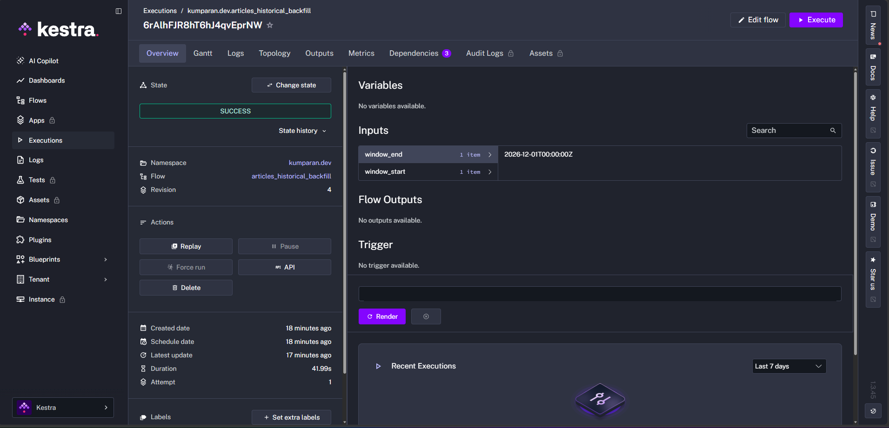

*Kestra completed the bounded historical backfill successfully.*

### 2. Execution timeline

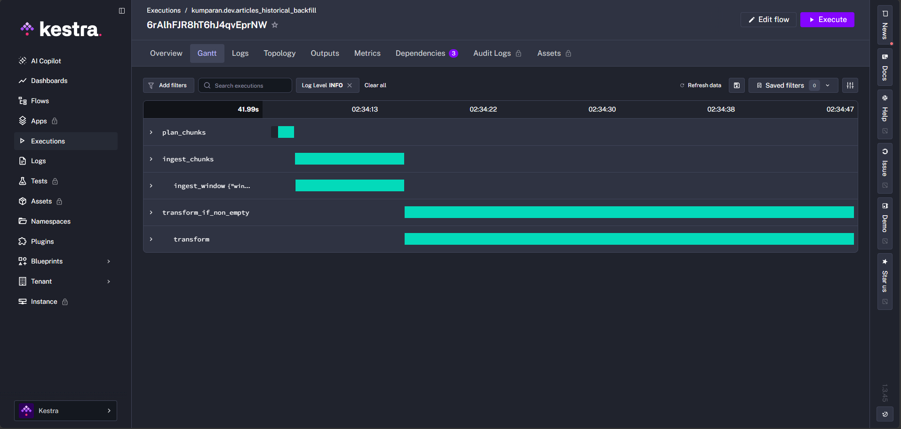

*The timeline shows ingestion completing before the dbt transformation.*

### 3. Workflow topology

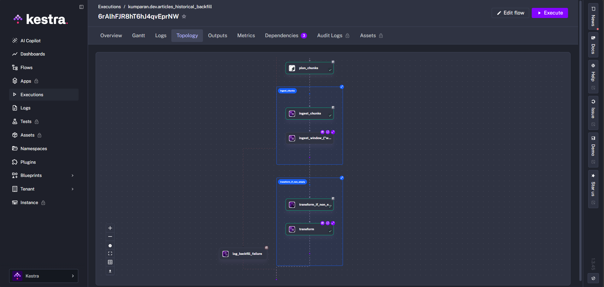

*The topology shows chunk planning, ingestion, and transformation dependencies.*

### 4. Raw GCS delivery

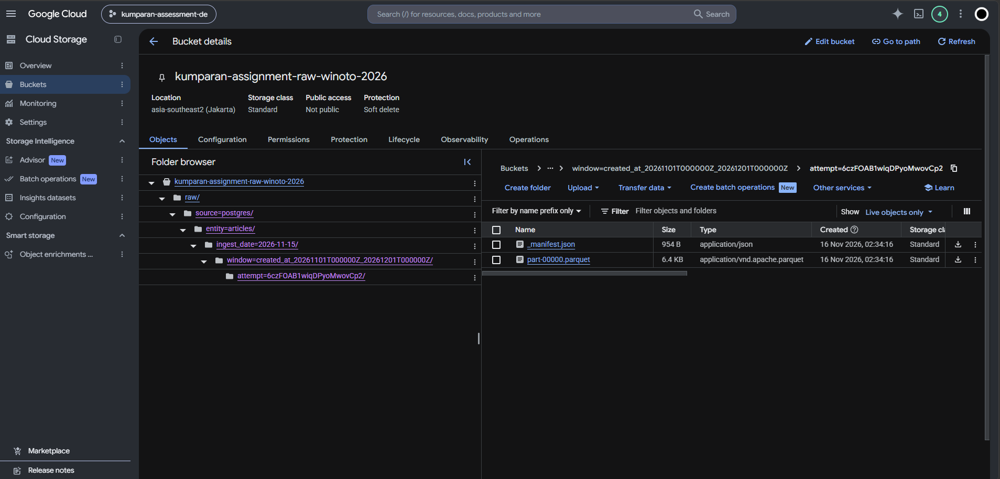

*The raw objects use the child window-ingestion execution ID as their immutable attempt ID.*

### 5. BigQuery landing table

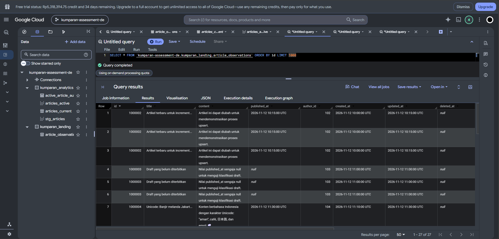

*The landing table preserves append-only article observations.*

### 6. Canonical current table

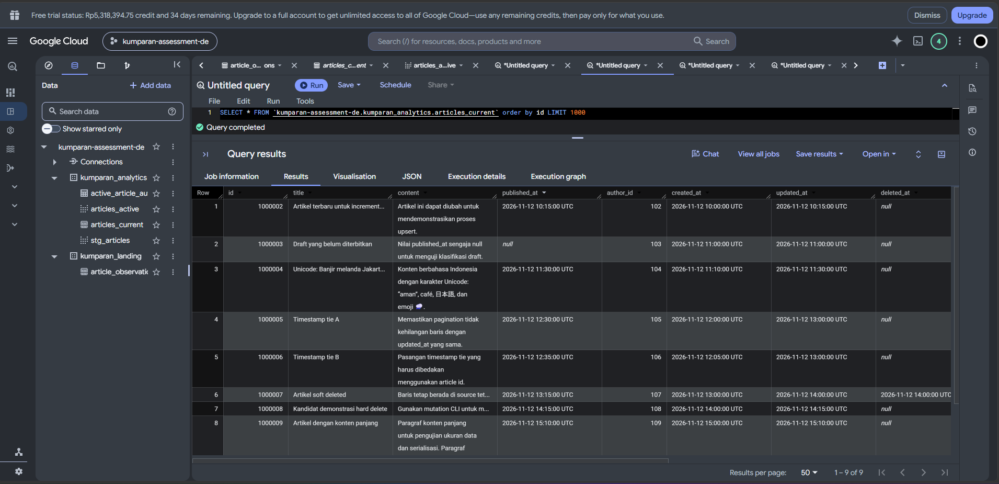

*The current model keeps one latest record per article ID.*

### 7. Active article view

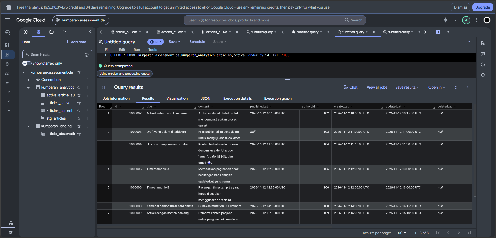

*The active view excludes the soft-deleted article.*

### 8. Analytical mart

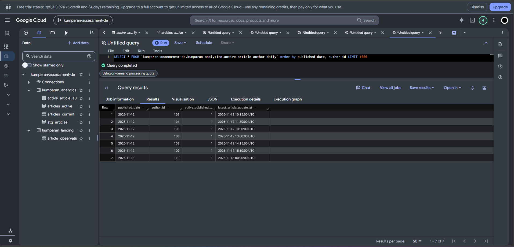

*The mart aggregates active published articles by date and author.*

## One-million-row volume test

### 1. Successful execution

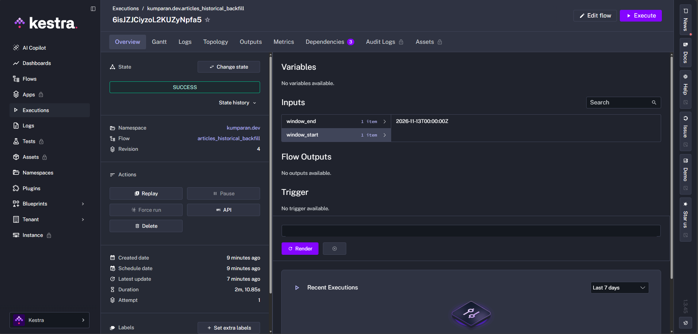

*Kestra completed the one-million-row backfill in 2 minutes 10.85 seconds.*

### 2. Extracted row count

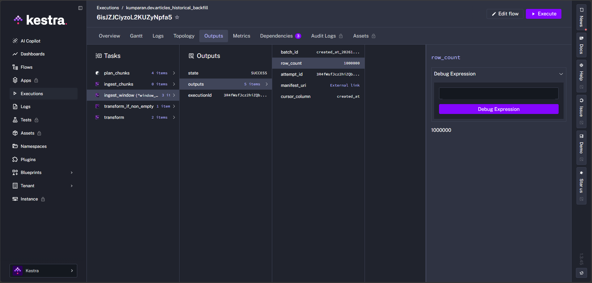

*The ingestion output reports exactly 1,000,000 extracted rows.*

### 3. Partitioned raw output

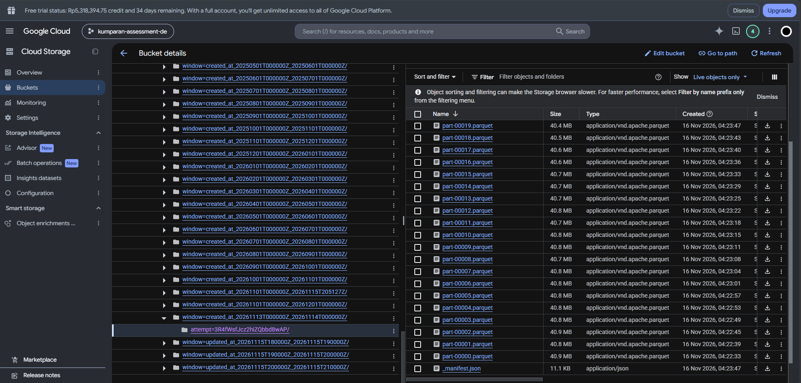

*The bounded extraction produced 20 Parquet parts and one completion manifest.*

### 4. Canonical row count

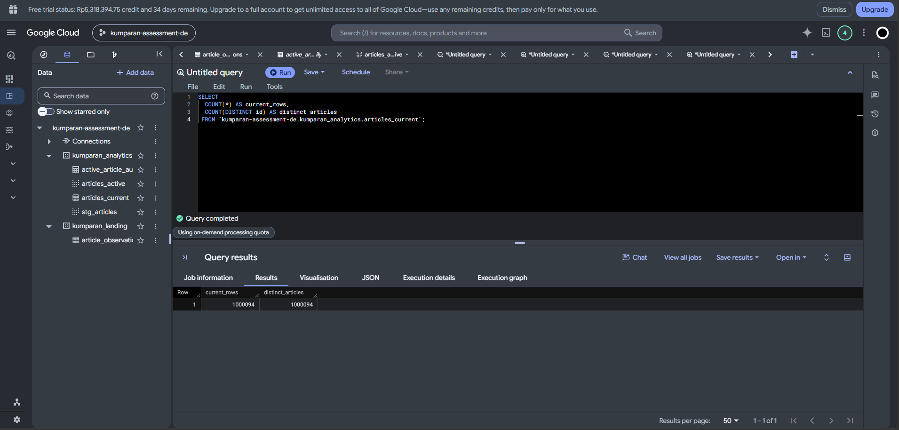

*The canonical table contains 1,000,094 distinct article IDs after including existing test data.*

### 5. BigQuery job metrics

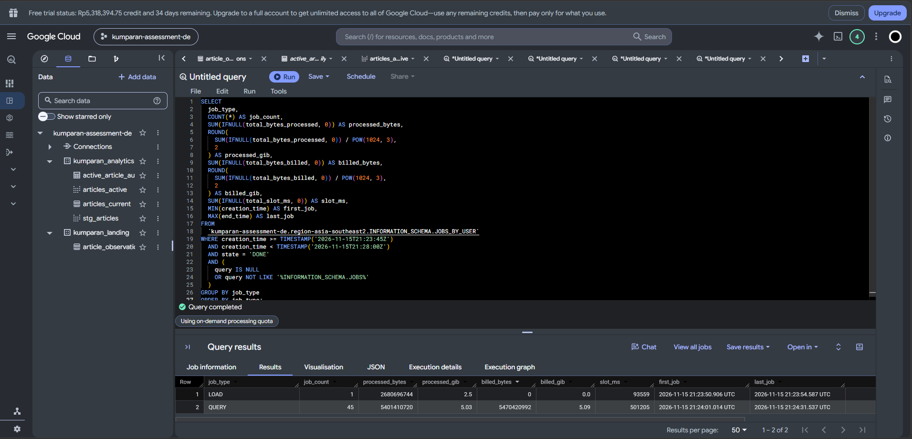

*The benchmark recorded 2.50 GiB loaded and 5.03 GiB processed across transformation queries.*
